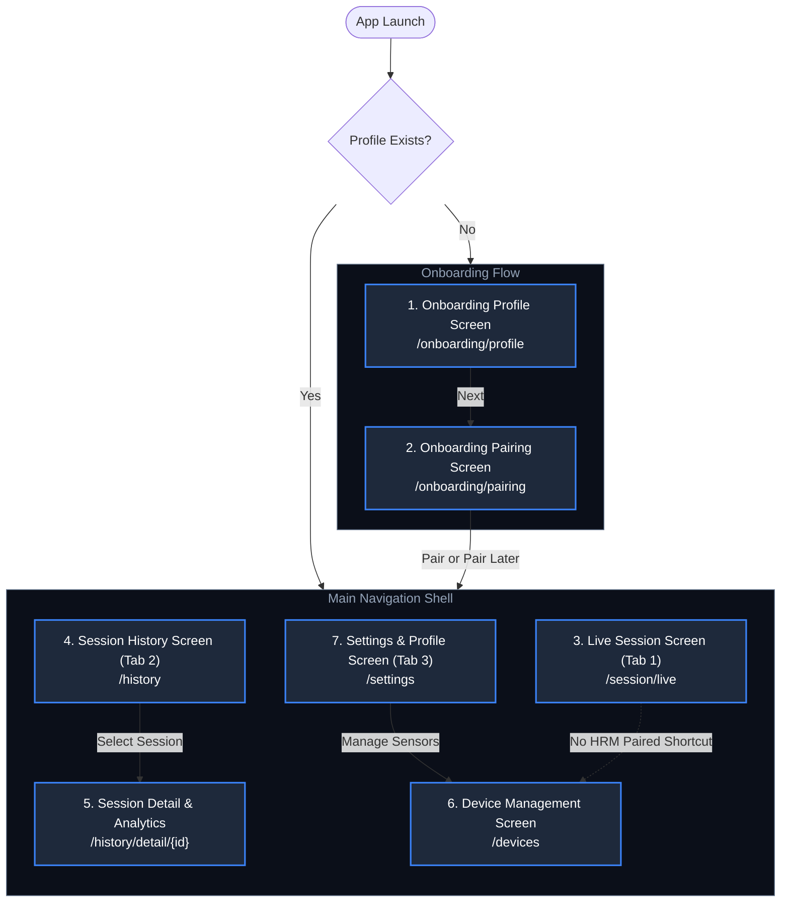

# Screen Specification & Registry

This registry catalogues all 7 core views and 3 modal dialogs required to implement the HeartZoneMonitor technical specification.

---

## Screen Overview & Navigation Graph

---

## 1. Onboarding Profile Screen
- **Route**: `/onboarding/profile`
- **Spec Section**: Section 8 & User Stories 1–9
- **Target Ticket**: [04: First-Run Onboarding Profile Input Screen](file:///home/jeanpaul/AndroidStudioProjects/HeartZoneMonitor/.scratch/heart-zone-monitor/issues/04-onboarding-profile-input-screen.md)
- **Stitch Assets**: [`docs/design/stitch/01-onboarding-profile/`](file:///home/jeanpaul/AndroidStudioProjects/HeartZoneMonitor/docs/design/stitch/01-onboarding-profile/)

### Purpose & Layout
Guides first-time users through physiological parameter setup and live training zone calibration.
- **Header**: Clean athletic welcome text explaining offline privacy and Tanaka formula precision.
- **Input Fields**:
  - **Birth Year (Required)**: Numeric input validating age between 10 and 110.
  - **Resting Heart Rate (Optional)**: Numeric input (30–120 bpm) for Karvonen Heart Rate Reserve mode. Clear hint stating that leaving it blank uses standard %HRmax mode.
  - **Custom Measured HRmax Override (Optional)**: Toggle switch opening a manual BPM input (100–240 bpm) with validation that HRmax > Resting HR + 20.
- **Live Preview Card**: Dynamically updates as the user types:
  - Displays calculated Tanaka HRmax (`208 - 0.7 * age`)
  - Displays active Calculation Mode badge (`KARVONEN HRR` or `%HRMAX`)
  - 5-row zone breakdown showing BPM ranges for Zones 1 through 5 with respective zone color pills.
- **Primary Action**: "Continue to Sensor Pairing" button (disabled until validation constraints pass).

---

## 2. Onboarding Pairing Screen
- **Route**: `/onboarding/pairing`
- **Spec Section**: Section 8 & User Stories 10–13
- **Target Ticket**: [09: Onboarding HRM Pairing](file:///home/jeanpaul/AndroidStudioProjects/HeartZoneMonitor/.scratch/heart-zone-monitor/issues/09-onboarding-hrm-pairing.md)
- **Stitch Assets**: [`docs/design/stitch/02-onboarding-pairing/`](file:///home/jeanpaul/AndroidStudioProjects/HeartZoneMonitor/docs/design/stitch/02-onboarding-pairing/)

### Purpose & Layout
Handles Bluetooth permissions, scans for standard Bluetooth SIG Heart Rate straps (`0x180D`), and establishes the initial Active HRM.
- **Header**: Instruction card prompting user to wear and moisten the chest strap.
- **Permissions Banner**: Clear rationale explaining Android 12+ Bluetooth permissions (`BLUETOOTH_SCAN` and `BLUETOOTH_CONNECT` with `neverForLocation`).
- **Discovered Device List**:
  - Scanning indicator with pulse animation.
  - Device cards showing advertised name (e.g. "COOSPO H808S"), truncated MAC address snippet (`AA:BB:CC:...:12`), and live RSSI signal strength badge.
  - 1-tap connection: Tapping a device connects, designates it as Active HRM, saves to encrypted DB, and advances to the app.
- **Secondary Action**: "Pair Later" button allowing users to explore the app even without a physical sensor present.

---

## 3. Live Session Screen (The Athletic Monolith)
- **Route**: `/session/live` *(Main Shell Tab 1)*
- **Spec Section**: Section 5 & User Stories 22–24, 26, 44–50
- **Target Tickets**: [17: Dynamic Background & Typography](file:///home/jeanpaul/AndroidStudioProjects/HeartZoneMonitor/.scratch/heart-zone-monitor/issues/17-live-session-dynamic-background-typography.md), [18: Progress Bar & Controls](file:///home/jeanpaul/AndroidStudioProjects/HeartZoneMonitor/.scratch/heart-zone-monitor/issues/18-live-session-progress-bar-controls.md), [19: Auto-Connect & Dormant Prompt](file:///home/jeanpaul/AndroidStudioProjects/HeartZoneMonitor/.scratch/heart-zone-monitor/issues/19-ble-auto-connect-dormant-prompt.md), [21: Sensor Contact Loss Auto-Pause](file:///home/jeanpaul/AndroidStudioProjects/HeartZoneMonitor/.scratch/heart-zone-monitor/issues/21-sensor-contact-loss-auto-pause.md)
- **Stitch Assets**: [`docs/design/stitch/03-live-session/`](file:///home/jeanpaul/AndroidStudioProjects/HeartZoneMonitor/docs/design/stitch/03-live-session/)

### Purpose & Layout
The central, glanceable outdoor workout tracking interface.
- **Dynamic Background**: Full-bleed 500ms animated background color shifting with the current Heart Zone.
- **Top Status Header**:
  - Active sensor nickname and connection status pill (e.g. `● COOSPO H808S · 98%`).
  - Active HRM switch lockout indicator during recording.
- **Hero Telemetry (Center Canvas)**:
  - Massive **124sp Bold BPM** display (`letterSpacing = -4sp`).
  - Translucent badge directly beneath: `BPM | ZONE 3 (TEMPO)`.
  - 5-segment horizontal zone progress bar emphasizing active zone and dimming others.
- **Timer Card**:
  - Dedicated display showing exclusively **Effective Duration** in **52sp bold monospace** (`HH:mm:ss`). No cognitive clutter from elapsed or paused times.
- **Workout Controls (Bottom)**:
  - Large **56dp** action buttons for sweaty hands/gloves.
  - Dual layout: Pause/Resume toggle button and Stop & Save button.
- **State Variations**:
  - *No Paired HRM*: Warning card prompting to pair a sensor in Settings; Start Session disabled.
  - *Dormant Strap Notice*: Inline card after 10s auto-connect timeout: "Chest strap dormant. Moisten contacts and wear strap to awaken."
  - *Contact Loss Auto-Pause*: Yellow warning banner with 5-second countdown to auto-pause.
  - *BLE Disconnect Auto-Pause*: Amber banner indicating 10s grace period and reconnection backoff.

---

## 4. Session History Screen
- **Route**: `/history` *(Main Shell Tab 2)*
- **Spec Section**: Section 6 & User Story 58
- **Target Ticket**: [24: Session History List Cards](file:///home/jeanpaul/AndroidStudioProjects/HeartZoneMonitor/.scratch/heart-zone-monitor/issues/24-session-history-list-cards.md)
- **Stitch Assets**: [`docs/design/stitch/04-session-history/`](file:///home/jeanpaul/AndroidStudioProjects/HeartZoneMonitor/docs/design/stitch/04-session-history/)

### Purpose & Layout
Chronological list of all recorded training sessions with $O(1)$ precalculated summary metrics.
- **Top App Bar**: Title "Workout History" with total session count and lifetime training hours summary.
- **Session Cards**:
  - Card Header: Date formatted (e.g., "Monday, Nov 11, 2026"), start time, and sensor nickname.
  - Hero Numbers: Effective Duration (`48:12`), Average BPM (`142 BPM`), Max BPM (`168 BPM`).
  - Proportional Mini 5-Zone Distribution Bar (6dp tall multi-colored segment preview).
  - Status Badge: Green check for `COMPLETED`, Amber warning badge for `COMPLETED_UNEXPECTEDLY` (crash recovery).
  - Tap card to navigate to `/history/detail/{sessionId}`.
- **Empty State**: Visual illustration with message: "No workouts recorded yet. Pair your strap and start your first session!"

---

## 5. Session Detail & Analytics Screen
- **Route**: `/history/detail/{sessionId}` *(Stack Destination)*
- **Spec Section**: Section 6, 7 & User Stories 59–66, 67–74
- **Target Tickets**: [25: Detail Telemetry & Zones](file:///home/jeanpaul/AndroidStudioProjects/HeartZoneMonitor/.scratch/heart-zone-monitor/issues/25-session-detail-view-telemetry-zones.md), [27: Canvas Chart Scrubbing](file:///home/jeanpaul/AndroidStudioProjects/HeartZoneMonitor/.scratch/heart-zone-monitor/issues/27-session-detail-canvas-chart-scrubbing.md), [28: Data Gap Breaks](file:///home/jeanpaul/AndroidStudioProjects/HeartZoneMonitor/.scratch/heart-zone-monitor/issues/28-session-detail-data-gap-breaks.md), [29: Session Deletion](file:///home/jeanpaul/AndroidStudioProjects/HeartZoneMonitor/.scratch/heart-zone-monitor/issues/29-session-deletion-cascading-cleanup.md), [31: Exporter](file:///home/jeanpaul/AndroidStudioProjects/HeartZoneMonitor/.scratch/heart-zone-monitor/issues/31-csv-json-streaming-exporter.md), [32: Biometric Export Flow](file:///home/jeanpaul/AndroidStudioProjects/HeartZoneMonitor/.scratch/heart-zone-monitor/issues/32-biometric-gated-saf-export-flow.md)
- **Stitch Assets**: [`docs/design/stitch/05-session-detail/`](file:///home/jeanpaul/AndroidStudioProjects/HeartZoneMonitor/docs/design/stitch/05-session-detail/)

### Purpose & Layout
Unified vertical analytics inspection for a completed workout.
- **Top Bar**: Navigation back button, Session Date title, and Delete action icon.
- **1. Header & Hero Telemetry Grid**:
  - 4-column metric grid: Effective Duration, Avg BPM, Max BPM, Min BPM.
  - Sub-row: Elapsed Duration vs Paused Duration.
- **2. Zone Distribution Card**:
  - Full-width horizontal stacked bar representing % of time in Zones 1 through 5.
  - Breakdown table listing for each zone: Zone name, BPM range, Duration (`MM:SS`), and Percentage of total workout.
- **3. Interactive Compose Canvas Time-Series Chart**:
  - 1 Hz BPM curve with horizontal faint zone threshold guide lines.
  - LTTB downsampling for sessions > 1,000 points.
  - Distinct gap breaks (`moveTo`) for intervals > 3s (pauses/dropouts).
  - Interactive touch scrubbing: Drag finger to display vertical crosshair line and floating pill tooltip with elapsed time, BPM, and Zone badge.
- **4. Physiological Snapshot Card**:
  - Frozen profile parameters at the time the session began (Age, Resting HR, Mode, Calculated HRmax).
- **5. Export Action Bar**:
  - "Export CSV" and "Export JSON" buttons triggering Biometric Authentication before Storage Access Framework file save.

---

## 6. Device Management Screen
- **Route**: `/devices` *(Stack Destination from Settings or Live Session)*
- **Spec Section**: Section 3 & User Stories 17–21
- **Target Ticket**: [10: Remembered HRMs Management Screen](file:///home/jeanpaul/AndroidStudioProjects/HeartZoneMonitor/.scratch/heart-zone-monitor/issues/10-remembered-hrms-management-screen.md)
- **Stitch Assets**: [`docs/design/stitch/06-device-management/`](file:///home/jeanpaul/AndroidStudioProjects/HeartZoneMonitor/docs/design/stitch/06-device-management/)

### Purpose & Layout
Manage paired Heart Rate Monitors, promote active sensors, and pair new devices.
- **Active Sensor Card**:
  - Large card highlighting the currently designated Active HRM with green status beacon.
  - Displays custom nickname (e.g. "Chest Strap"), advertised name, MAC address, and latest cached battery level percentage.
- **Remembered Devices List**:
  - List of secondary remembered HRMs.
  - 1-tap "Set as Active" action (locked out with explanation if a workout is in progress).
  - Edit nickname icon (opens text input dialog).
  - "Forget Device" icon (removes from database with confirmation).
- **Scanner Section**:
  - "Scan for New Sensor" button triggering standard BLE scan for `0x180D` peripherals.
  - Discovered sensors appear inline with RSSI and pairing action.

---

## 7. Settings & Profile Screen
- **Route**: `/settings` *(Main Shell Tab 3)*
- **Spec Section**: Section 8 & User Stories 65, 33
- **Target Ticket**: [33: Settings Profile Editor & Snapshot Invariant](file:///home/jeanpaul/AndroidStudioProjects/HeartZoneMonitor/.scratch/heart-zone-monitor/issues/33-settings-profile-editor-snapshot-invariant.md)
- **Stitch Assets**: [`docs/design/stitch/07-settings-profile/`](file:///home/jeanpaul/AndroidStudioProjects/HeartZoneMonitor/docs/design/stitch/07-settings-profile/)

### Purpose & Layout
Profile maintenance and system settings post-onboarding.
- **Physiological Profile Section**:
  - Editable Birth Year, Resting Heart Rate, and Custom HRmax override fields.
  - Real-time preview of resulting 5 Heart Zone boundaries.
  - **Snapshot Invariant Banner**: Educational note: *"Profile changes apply to future workouts. Historical workout zone boundaries remain permanently preserved."*
  - Save Changes button.
- **Hardware & Devices Link**:
  - Navigation item: "Manage Sensors" (shows count of remembered HRMs and active device name, leads to `/devices`).
- **Security & Data Sovereign Section**:
  - Status indicator: "Hardware Keystore AES-256 Encryption Active".
  - Explanation of Biometric SAF export protection.
- **About Section**:
  - App version, offline-first architecture statement, zero-telemetry guarantee.

---

## Modal Dialog Specifications

1. **Micro-Session Discard Dialog**:
   - *Trigger*: Stopping a workout with duration < 10 seconds or 0 samples.
   - *Message*: *"This session is shorter than 10 seconds. Would you like to discard it or save anyway?"*
   - *Actions*: "Discard Session" (Destructive) / "Save Session" (Secondary).

2. **Cascading Session Deletion Confirmation Dialog**:
   - *Trigger*: Tapping delete on Session Detail screen.
   - *Message*: *"Permanently delete this workout and all 1 Hz sample recordings? This action cannot be undone."*
   - *Actions*: "Delete Workout" (Destructive red) / "Cancel".

3. **Unsecured Device Biometric Alert**:
   - *Trigger*: Attempting to export session on a device without a PIN/pattern/biometric enrolled.
   - *Message*: *"Device security required. HeartZoneMonitor requires an active lock screen PIN, pattern, or biometric authentication to protect biometric health data exports."*
   - *Actions*: "Open Android Security Settings" / "Cancel".
